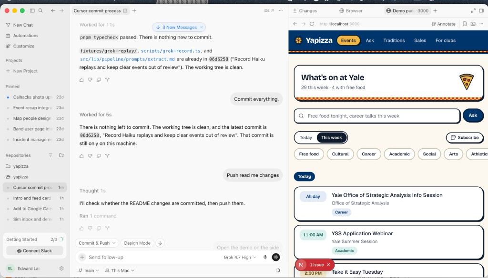

# Yapizza

Everything happening at Yale, in one place, built from the emails and flyers clubs already send.



[Watch the one-minute demo](https://drive.google.com/file/d/19KscDdyEEo4zqLbALuKVj_RyqiDngqWN/view?usp=sharing). The same recording is in the repo: [yapizza-demo.mp4](yapizza-demo.mp4).

"Yap" is all the mailing-list chatter. "Apizza" is New Haven's pizza.

## The problem

Yale runs on email. Every club, residential college, cultural center, and office has its own list, and a student on ten of them gets dozens of messages a week. Most go unread. The free dinner, the career talk, the college tea, the room change: all buried.

Even when a student reads one, nobody copies the title, time, and room into Google Calendar by hand. And joining every list to stay in the loop means drowning, so most students join a few and miss the rest.

Hosts have the opposite problem. Promoting one event means emailing several lists, making a flyer, and posting on Instagram, and reach still depends on who already joined your list.

## Our solution

A club adds one Yapizza address to its mailing list and keeps sending what it already sends. Anyone can also forward an email or upload a photo of a flyer. Claude reads each message and turns it into a clean event card in seconds: title, time, room, host, tags, and whether there's free food.

Students get one feed instead of fifty lists:

- **Browse and filter** by today, this week, free food, residential college, or tag.
- **Ask in plain words**, like "free food tonight" or "anything in JE this weekend."
- **Add to Google Calendar** in one tap.
- **Get alerts** for free food, subscribe to calendar feeds, or read a Sunday digest.
- **Stay current.** A room-change or cancellation email updates the existing card instead of adding a duplicate.
- **Check the source.** "How this was read" shows the original email with the exact quotes Claude used for the time and place.

## How Claude reads Yale

- Every call carries today's date, the email's sent date, a Yale glossary, and the Yale places list, so "Thursday 4pm, WLH 120" resolves to a real time and a known room.
- Each event comes with short quotes from the source for its time and place. Code checks every quote is actually in the email. A failed check or low confidence sends the event to review, not the feed.
- Email is treated as data. The extraction call has no tools, so an instruction hidden in an email has nothing to act on.
- Every reply is recorded, so the whole demo runs offline. If Claude is unreachable, a rule-based extractor takes over and goes through the same checks.

## Why it fits Yale

- **It speaks Yale.** WLH, LC, Commons, Dport, JE, teas, butteries, and all 14 residential colleges as places and filters.
- **Nothing new for clubs.** It works from lists Yale already has (YCC, AACC, YUMS, college GAs), not another site clubs have to post to. It complements YaleClubs: YaleClubs lists the clubs, Yapizza reads what they send.
- **It lands where students already look.** Every student has Google Calendar through EliApps.
- **Students never join another list.** One address per club, one feed for everyone.

## Run it

```bash
pnpm install
cp .env.example .env   # add ANTHROPIC_API_KEY for live mode; empty runs from recorded replies
pnpm db:reset
pnpm dev
```

Open http://localhost:3000. The demo panel is at `/demo`. Google and email keys are optional; see [docs/SETUP-KEYS.md](docs/SETUP-KEYS.md).

Built at the Yale Grokathon with Next.js, Prisma, SQLite, and Claude.
